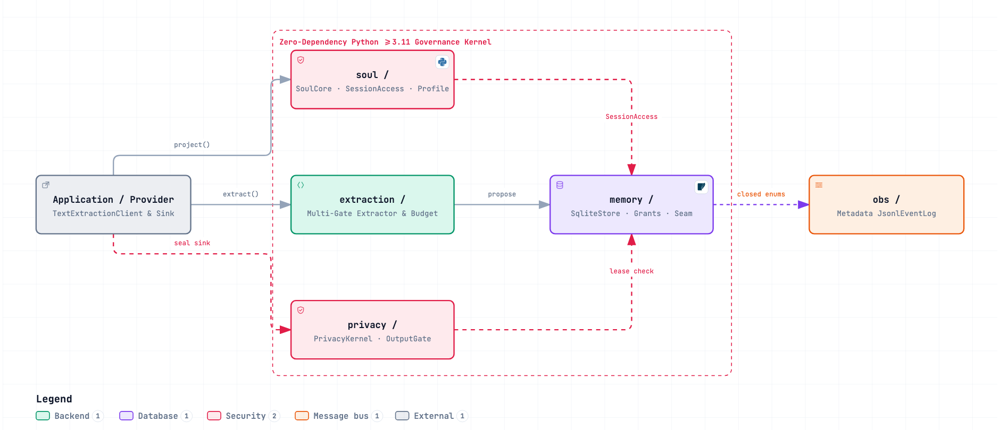

# soul-memory-kernel

[](https://github.com/rockcli/soul-memory-kernel/actions/workflows/ci.yml)
[](https://github.com/rockcli/soul-memory-kernel/releases/tag/v0.1.0)
[](https://www.python.org/)
[](#installation)
[](LICENSE)

**English** | [简体中文](README.zh-CN.md)

A pure-Python (`>=3.11`, zero third-party runtime dependencies) privacy-first kernel for AI assistants. It provides deterministic **Soul projection**, **scoped SQLite memory governance**, **single-policy output gating**, **metadata-only JSONL observability**, and **multi-gate budgeted memory extraction**.

---

## Architecture

<p align="center">
  <picture>
    <source media="(prefers-color-scheme: dark)" srcset="docs/architecture-dark.png" />
    <source media="(prefers-color-scheme: light)" srcset="docs/architecture-light.png" />
    
  </picture>
</p>

### Module Overview

| Package | Responsibility |
|---|---|
| `soul_memory_kernel.soul` | Local `SoulCore` identity/values/personality persistence, fixed behavior boundaries, `FamilyProfileStore`, `SessionAccess` modes, and `project_session_memory` / `project_session_pending` projection seams. |
| `soul_memory_kernel.memory` | SQLite-backed `MemoryService` & `SqliteMemoryStore` (with automatic schema migrations), fail-closed `authorize`/`require` policy engine, recursive provenance grant checks, `SqlitePendingStore`, `proposal_intent` rule evaluation, and local control-plane `cli`. |
| `soul_memory_kernel.privacy` | Synthetic `PrivacyKernel` authorization leases, `ControlledOutputGate` sealing text + audio chunks for atomic allow/deny release, `PrivacyOutput`, `PrivacySessionCoordinator`, and provider-independent `provider_types`. |
| `soul_memory_kernel.extraction` | Multi-gate `Extractor` & `ExtractionScheduler` (switch, eligibility, negation, trigger, atomic SQLite daily/session `ExtractionBudget`, strict JSON schema validation) accepting any protocol-compatible `TextExtractionClient`. |
| `soul_memory_kernel.obs` | Append-only `JsonlEventLog` with strict payload allowlisting and closed-set enums — never persisting transcripts, memory text, record IDs, or raw audio. |

---

## Core Guarantees

- **Fail-Closed Authorization & Provenance**: Every memory read (`read_model`), outbound projection (`send_provider`), and mutation checks explicit `SessionAccess`, consent version, TTL/status, and recursive ancestor provenance grants.
- **Unverified Speaker Safety**: `SoulCore.project()` treats speakers as unverified by default and enforces fixed behavioral boundaries without leaking member profiles into provider instructions.
- **Type-Safe Projection Seams**: `SoulCore.project()` only accepts `MemoryProjection` / `PendingProjection` produced after per-entry `send_provider` re-authorization — raw snapshots cannot bypass the seam.
- **Atomic Extraction Cost Fuses**: `SqliteMemoryStore.consume_extraction_budget()` uses a single conditional SQLite `UPSERT` (`WHERE call_count < ?`) so concurrent connections never exceed daily limits.
- **Zero-Content Observability**: `obs.events` strips all free-text fields, dynamic keys, and nested payloads, retaining only presence bits, bounded counts, and closed-set enum reasons.

---

## Installation

Requires Python `>=3.11`. No third-party runtime packages are needed.

```bash
# Editable install with uv
uv pip install -e .

# Or standard pip
pip install -e .
```

---

## Quickstart

### 1. Local Soul Projection

```python
from pathlib import Path
from soul_memory_kernel.soul import SoulCore, create_soul_config

config_path = Path("data/soul.json")
family_db = Path("data/family.sqlite3")

create_soul_config(config_path, name="Atlas")
session_cfg = SoulCore(config_path, family_db).project()
print(session_cfg.instructions)
```

### 2. Scoped Memory Service & Projection Seam

```python
from pathlib import Path
from soul_memory_kernel.memory import (
    Actor,
    MemoryCandidate,
    MemoryService,
    RetentionPolicy,
    SourceSession,
    SqliteGrantStore,
    SqliteMemoryStore,
)
from soul_memory_kernel.soul import SessionAccess, project_session_memory

db_path = Path("data/memory.sqlite3")
store = SqliteMemoryStore(db_path)
store.create_schema()
grants = SqliteGrantStore(db_path)
service = MemoryService(store, grants, clock=lambda: "2026-01-01T00:00:00Z")

actor = Actor(kind="adult_control_plane", actor_id="local-admin")
record = service.propose(
    MemoryCandidate(
        owner_id="family_shared",
        scope="FAMILY",
        memory_class="PREFERENCE",
        content="Prefers concise reminders in the morning.",
        source_type="explicit_user",
        confidence=1.0,
        importance=0.6,
        requested_policy=RetentionPolicy(mode="persist_confirmed"),
        audiences=frozenset({"family_all"}),
    ),
    SourceSession(session_id="sess-1", source_member_id=None),
    actor=actor,
)
service.confirm(record.id, actor=actor)

projection = project_session_memory(
    db_path=db_path,
    access=SessionAccess.for_manual_selection(None),
    memory_enabled=True,
)
print(projection.projected_count)
```

### 3. CLI Tools

```bash
# Initialize local soul config
soul-memory-soul --config data/soul.json init --name Atlas

# Inspect or confirm pending memories via local control plane
soul-memory-cli --db data/memory.sqlite3 list
```

---

## Non-Goals

- **Not user or speaker authentication** — `speaker_claim` and manual selection never unlock `PERSONAL` or `SAFETY` scopes/profiles, and `PrivacyKernel.open_session()` ignores `SpeakerObservation`.
- **No `PERSONAL` or `SAFETY` scope recall in M2.1** — `M2_1_ALLOWED_SCOPES` is fixed to `{"FAMILY"}` on both reads and writes (`memory_class="SAFETY"`, such as allergies, still operates within `FAMILY` scope).
- **No bundled network or LLM transport** — Zero outbound network code ships in this package; `default_client_factory()` raises `TextExtractionAdapterMissing` unless the caller injects a `TextExtractionClient`.
- **Experimental `privacy` package** — `PrivacyKernel(enabled=False)` and `ControlledOutputGate` are synthetic, default-off modules without a production grant issuer or semantic content safety filter; ordering invariants terminate at `sink.enqueue` / `stop`.
- **Cost fuse, not a tamper-proof quota boundary** — Daily extraction budgets live in the local `extraction_usage` table inside `memory.sqlite3`; switching or deleting the DB resets counters.

## Known Pitfalls

- **Orphan provenance rows are intentional (`memory_source.source_id` has no FK)** — Adding `ON DELETE CASCADE` would wipe provenance links when an ancestor is deleted and make derived memories appear ancestor-free; instead, ancestor deletion leaves derived rows permanently unreachable (`missing_provenance`).
- **SQLite schema rebuilds with foreign keys** — Running `DROP TABLE memory_record` while `PRAGMA foreign_keys = ON` silently triggers cascading deletes on `memory_audience` and `memory_source` without error, and `PRAGMA foreign_keys = OFF` is ignored inside a transaction. Migrations must disable foreign keys *before* `BEGIN IMMEDIATE` and re-verify via `PRAGMA foreign_key_check`.
- **`revoked` vs `expired` grant semantics** — `SqliteGrantStore.load_for_session()` filters `revoked_at IS NULL` so revoked grants collapse into `no_grant` (preventing revive bugs on higher versions), whereas `expired` and `not_yet_valid` (`now < issued_at`) surface as explicit deny reasons.

## Security & Trust Boundaries

- **File & SQLite hardening** — Zero third-party runtime dependencies and zero outbound network calls. `memory.sqlite3` enforces `0600` permissions, rejects symlinks, validates `PRAGMA quick_check` and `user_version == 3`, and opens all read/projection paths with `?mode=ro`.
- **Projection seam & anti-injection** — `SoulCore.project()` rejects raw `MemorySnapshot` / `PendingItem` inputs at runtime, re-authorizes each entry against its live provenance closure (failing closed on empty closures if a record was concurrently deleted), folds control/newline characters to single-line bullets, and places `FIXED_BEHAVIOR_BOUNDARIES` after memory blocks.
- **Metadata-only observability & safe CLI** — `obs.events` drops unknown event names, dynamic keys, nested dicts, and free text. `soul-memory-cli` never reads provider API keys from `.env`, suppresses raw exception messages, and refuses non-TTY destructive actions (`delete`, `sweep`, `grant revoke`) without `--yes`.

---

## Running Tests

The test suite includes an automatic offline network guard (`tests/conftest.py`) that blocks any non-loopback network resolution or socket connection.

```bash
uv run --python 3.13 --with pytest --with pytest-asyncio pytest
```
