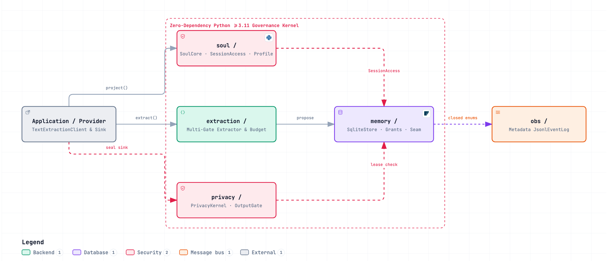

# soul-memory-kernel

[](https://github.com/rockcli/soul-memory-kernel/actions/workflows/ci.yml)
[](https://github.com/rockcli/soul-memory-kernel/releases/tag/v0.1.0)
[](https://www.python.org/)
[](#安装)
[](LICENSE)

[English](README.md) | **简体中文**

纯 Python 标准库实现（`>=3.11`，零第三方运行时依赖）的隐私优先 AI 内存与灵魂内核，提供确定性的 **Soul 投影**、**作用域受控 SQLite 记忆治理**、**单一策略输出闸门**、**纯元数据 JSONL 可观测性**与**多闸门预算受控提取编排**。

---

## 架构概览

<p align="center">
  <picture>
    <source media="(prefers-color-scheme: dark)" srcset="docs/architecture-dark.png" />
    <source media="(prefers-color-scheme: light)" srcset="docs/architecture-light.png" />
    
  </picture>
</p>

### 模块说明

| 模块 | 职责 |
|---|---|
| `soul_memory_kernel.soul` | 本地 `SoulCore` 身份/价值观/表达偏好持久化、固定行为边界、`FamilyProfileStore`、`SessionAccess` 访问模式，以及 `project_session_memory` / `project_session_pending` 投影接缝。 |
| `soul_memory_kernel.memory` | 基于 SQLite 的 `MemoryService` 与 `SqliteMemoryStore`（含自动 schema 迁移）、fail-closed `authorize`/`require` 判权引擎、递归血缘授权校验、`SqlitePendingStore`、`proposal_intent` 本地意图判定及本机控制面 `cli`。 |
| `soul_memory_kernel.privacy` | 合成授权租约 `PrivacyKernel`、封装文本与音频分片统一放行/拒绝的 `ControlledOutputGate`、`PrivacyOutput`、`PrivacySessionCoordinator` 及协议无关类型 `provider_types`。 |
| `soul_memory_kernel.extraction` | 多重前置闸门 `Extractor` 与 `ExtractionScheduler`（总开关、成人资格、否定词、触发器、SQLite 原子日/会话预算 `ExtractionBudget`、严格 JSON Schema 校验），通过 `TextExtractionClient` 协议接入外部模型。 |
| `soul_memory_kernel.obs` | 追加写 `JsonlEventLog`，采用严格白名单与闭集枚举校验，不落盘任何对话原文、记忆正文、记录 ID 或原始音频。 |

---

## 核心特性

- **Fail-Closed 判权与血缘递归**：所有记忆读取（`read_model`）、出境投影（`send_provider`）与写入变更均校验 `SessionAccess`、同意版本、生命周期状态与祖先链授权。
- **未认证说话人防护**：`SoulCore.project()` 默认将当前说话人视为未认证状态，严格隔离私人成员档案与固定行为边界。
- **类型强约束投影接缝**：`SoulCore.project()` 仅接受经过 `send_provider` 逐条复判产出的 `MemoryProjection` / `PendingProjection`，原始快照无法绕过接缝。
- **原子化提取成本熔断**：`SqliteMemoryStore.consume_extraction_budget()` 通过单条条件 `UPSERT`（`WHERE call_count < ?`）保证并发下日预算绝不越界。
- **零正文日志审计**：`obs.events` 丢弃所有自由文本、动态键与嵌套字典，只记录存在位、有界计数和闭集原因码。

---

## 安装

需要 Python `>=3.11`，无任何第三方运行时依赖：

```bash
uv pip install -e .
# 或
pip install -e .
```

---

## 非目标

- **不做说话人/用户身份认证** — `speaker_claim` 与手动切换身份绝不会解锁 `PERSONAL` / `SAFETY` 作用域或档案；`PrivacyKernel.open_session()` 会直接忽略 `SpeakerObservation`。
- **M2.1 阶段不开放 `PERSONAL` / `SAFETY` 作用域读写** — `M2_1_ALLOWED_SCOPES` 固定仅允许 `{"FAMILY"}`（过敏等 `memory_class="SAFETY"` 记录仍在 `FAMILY` 作用域内流转）。
- **不内置网络或 LLM 客户端** — 仓库零外网请求代码；未注入 `TextExtractionClient` 时，`default_client_factory()` 直接抛出 `TextExtractionAdapterMissing`。
- **`privacy` 包仍为默认关闭的实验模块** — `PrivacyKernel(enabled=False)` 与 `ControlledOutputGate` 目前属于合成验证组件，不含生产级授权签发器或语义内容安全审核；排序保障仅延伸至 `sink.enqueue` / `stop`。
- **提取预算仅作成本熔断** — 日调用计数保存在 `memory.sqlite3` 的 `extraction_usage` 表中，更换或删除数据库文件会重置计数。

## 已知坑点

- **`memory_source.source_id` 刻意不加外键与级联删除** — 若使用 `ON DELETE CASCADE`，删除祖先记录会同时抹掉血缘关系，导致衍生记忆看似“无上游祖先”而被意外召回；当前设计保留孤立血缘行，让衍生记录永久进入 `missing_provenance` 不可达状态。
- **SQLite 开启外键时的 `DROP TABLE` 隐式清空陷阱** — 在 `PRAGMA foreign_keys = ON` 下执行 `DROP TABLE memory_record` 会静默触发外键级联删除并清空 `memory_audience`，且事务内执行 `PRAGMA foreign_keys = OFF` 无效；表重建迁移必须在 `BEGIN IMMEDIATE` 之前关闭外键并在提交前校验 `PRAGMA foreign_key_check`。
- **`revoked` 与 `expired` 的语义区分** — `load_for_session()` 会直接过滤 `revoked_at IS NOT NULL` 使吊销授权表现为 `no_grant`（并阻断同 `grant_id` 升版本复活），而 `expired` 与 `not_yet_valid`（`now < issued_at`）则会作为显式拒绝码保留。

## 安全与信任边界

- **文件与数据库隔离** — 零第三方运行时依赖、零出境请求。`memory.sqlite3` 强制校验 `0600` 属主权限、拒绝符号链接、检查 `PRAGMA quick_check` 与 `user_version == 3`，所有只读与投影链路统一以 SQLite `?mode=ro` 打开。
- **投影接缝与提示词防注入** — `SoulCore.project()` 运行时拒绝未经接缝的原始快照，针对每条记录在当次查询后重新校验实时血缘闭包（若并发删库返回空闭包则 fail-closed 拦截），将控制符与换行折叠为单行输出，并把固定行为边界置于记忆块之后。
- **零正文审计与受控 CLI** — `obs.events` 严格按白名单清洗事件负载并丢弃所有自由文本。`soul-memory-cli` 不从 `.env` 读取外部模型密钥、输出脱敏错误提示，并在非交互终端执行破坏性命令（`delete`、`sweep`、`grant revoke`）时强制要求 `--yes`。

---

## 运行测试

测试套件内置仓库级离线网络守门（`tests/conftest.py`），自动阻断所有非 loopback 地址解析与外网连接：

```bash
uv run --python 3.13 --with pytest --with pytest-asyncio pytest
```
